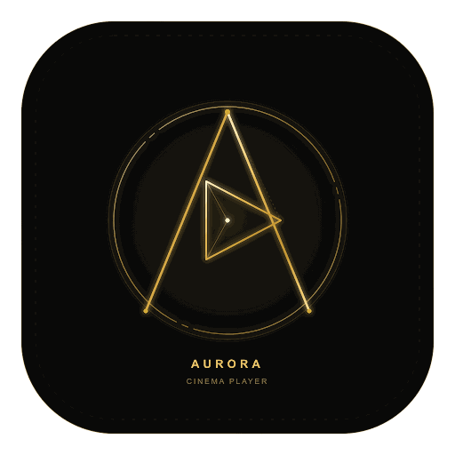

# Aurora Player

<p align="center">
  <strong>A simple, beautiful media player for Windows.</strong>
</p>

<p align="center">
  
</p>

## About Aurora Player

**Aurora Player** is a modern desktop media player designed for Windows 11. It aims to combine a clean, elegant interface with reliable media playback and a comfortable user experience.

Built with **Go**, **MyGo**, and the powerful **libmpv** playback engine, Aurora Player brings together native Windows integration and a modern graphical interface.

The goal is simple: make watching videos feel effortless.

## Current Features

- Video playback powered by libmpv
- Playlist and playback controls, including removing individual queue items
- Fullscreen playback with an auto-hiding floating controller
- **Cinematic Mode** for distraction-free windowed or fullscreen viewing
- **Smart Resume** offers to continue a video from its last saved position or start over
- External subtitle loading, strict filename matching, per-video external subtitle restoration, drag-and-drop, custom text/outline colors, and language-specific appearance profiles
- Keyboard shortcuts for playback, seeking, volume, fullscreen, and Cinematic Mode

### Cinematic Mode

Press **C** or use the Cinematic Mode button to hide the normal player interface and expand the video to the available window area. Move the pointer to reveal the floating playback controller; it automatically hides after a short period of inactivity. Press **C** or **Esc** to leave Cinematic Mode.

### Subtitle Studio (in progress)

Load external SRT, ASS/SSA, WebVTT, or SUB subtitle files while a video is playing. The initial Studio controls font family, size, text color, outline thickness, vertical position, and subtitle delay. Appearance defaults are stored locally; language-specific profiles can be saved from the Studio when the active track exposes language metadata. Embedded track selections are not yet persisted between sessions.

### Smart Resume

When you open a video with saved progress, Aurora offers **Resume** or **Start over**. Progress is stored locally in a versioned JSON file under your Windows user configuration directory. The history is limited to 500 videos and 1 MiB; the least recently watched entries are removed when a limit is reached. Automatic queue playback always starts at the beginning and does not interrupt playback with a resume prompt.

## Technology

| Technology | Purpose |
|---|---|
| Go | Main programming language |
| MyGo | Desktop application framework |
| libmpv | Media playback engine |
| purego | Calling native Windows APIs |
| Win32 API | Windows video hosting and integration |

## Requirements

- Windows 11 (64-bit)
- Go 1.27.3 or a compatible version
- MyGo v0.9.2
- libmpv runtime files

## Building from Source

1. Clone the project.
2. Install Git LFS and run `git lfs pull` to download the MPV runtime DLLs tracked outside normal Git storage.
3. Install the Go version declared in `go.mod` and download Go dependencies with `go mod download`.
4. Run the test suite with `go test ./...`.
5. Build the Windows application:

```powershell
go tool mygo build -platform windows/amd64
```

The build output and packaged resources are configured in `mygo.json`. The MPV DLLs must be real LFS-downloaded files in `third_party/mpv`; the small LFS pointer text files are not usable runtime libraries.

## Developer Documentation

New contributors can start with the [Developer Guide](docs/DEVELOPER_GUIDE.md), then use the [Source Reference](docs/SOURCE_REFERENCE.md) for a file-by-file and method-by-method explanation. The shorter [Architecture](ARCHITECTURE.md) and [Design System](DESIGN_SYSTEM.md) documents remain available for layer boundaries and visual rules.

## Project Status

Aurora Player is currently in early development.

The current focus is on:

- Reliable playback
- A polished and consistent user interface
- Clean project architecture
- Better Windows integration
- Stability and performance

A media library and more advanced features may be considered in future versions. The priority is to make the core player solid before expanding its functionality.

## Roadmap

- [ ] Improve playback stability
- [ ] Refine the user interface
- [ ] Improve application architecture
- [x] Add Cinematic Mode
- [ ] Complete Subtitle Studio (per-video subtitle matching and language profile editor)
- [ ] Add more playback options
- [ ] Improve accessibility and usability
- [ ] Explore support for additional platforms

## Screenshots

More screenshots will be added as the project develops.

## License

Aurora Player is licensed under the MIT License.

You are free to use, copy, modify, merge, publish, distribute, sublicense, and sell copies of the software, subject to the terms of the MIT License.

---

<p align="center">
  <strong>Aurora Player</strong><br>
  <em>A clearer, calmer way to enjoy your media.</em>
</p>
