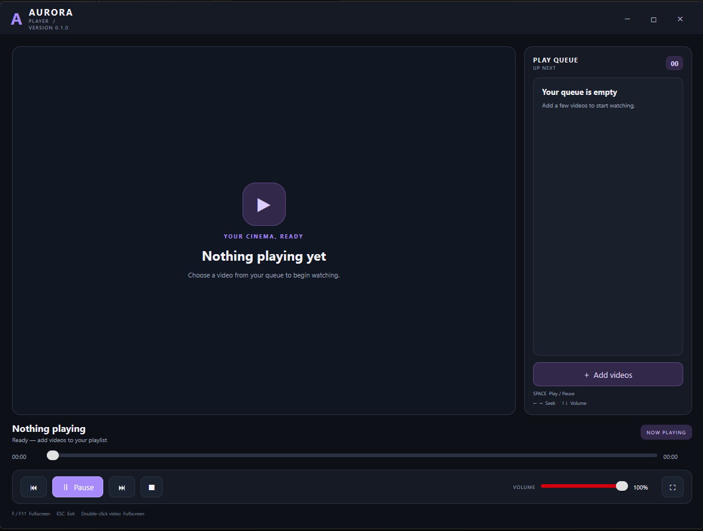

# Aurora Player

<p align="center">
  <strong>A simple, beautiful media player for Windows.</strong>
</p>

<p align="center">
  
</p>

## About Aurora Player

**Aurora Player** is a modern desktop media player designed for Windows 11. It aims to combine a clean, elegant interface with reliable media playback and a comfortable user experience.

Built with **Go**, **MyGo**, and the powerful **libmpv** playback engine, Aurora Player brings together native Windows integration and a modern graphical interface.

The goal is simple: make watching videos feel effortless.

## Current Features

- Video playback powered by libmpv
- Playlist and playback controls
- Fullscreen playback with an auto-hiding floating controller
- **Cinematic Mode** for distraction-free windowed or fullscreen viewing
- Keyboard shortcuts for playback, seeking, volume, fullscreen, and Cinematic Mode

### Cinematic Mode

Press **C** or use the Cinematic Mode button to hide the normal player interface and expand the video to the available window area. Move the pointer to reveal the floating playback controller; it automatically hides after a short period of inactivity. Press **C** or **Esc** to leave Cinematic Mode.

## Technology

| Technology | Purpose |
|---|---|
| Go | Main programming language |
| MyGo | Desktop application framework |
| libmpv | Media playback engine |
| purego | Calling native Windows APIs |
| Win32 API | Windows video hosting and integration |

## Requirements

- Windows 11 (64-bit)
- Go 1.27.3 or a compatible version
- MyGo v0.9.2
- libmpv runtime files

## Building from Source

1. Clone or download the project.
2. Make sure the required Go dependencies are installed.
3. Check that the MPV runtime files are available in `third_party/mpv`.
4. Open a terminal in the project directory.
5. Run:

```powershell
go tool mygo build -platform windows/amd64
```

The build output is configured in `mygo.json`.

## Project Status

Aurora Player is currently in early development.

The current focus is on:

- Reliable playback
- A polished and consistent user interface
- Clean project architecture
- Better Windows integration
- Stability and performance

A media library and more advanced features may be considered in future versions. The priority is to make the core player solid before expanding its functionality.

## Roadmap

- [ ] Improve playback stability
- [ ] Refine the user interface
- [ ] Improve application architecture
- [x] Add Cinematic Mode
- [ ] Add more playback options
- [ ] Improve accessibility and usability
- [ ] Explore support for additional platforms

## Screenshots

More screenshots will be added as the project develops.

## License

Aurora Player is licensed under the MIT License.

You are free to use, copy, modify, merge, publish, distribute, sublicense, and sell copies of the software, subject to the terms of the MIT License.

---

<p align="center">
  <strong>Aurora Player</strong><br>
  <em>A clearer, calmer way to enjoy your media.</em>
</p>
